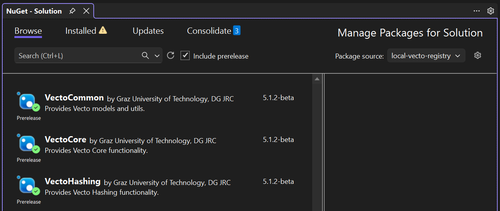

# BuildTools

PowerShell scripts for managing VECTO releases and beta packages.

---

## build_beta_release.ps1

Builds the VECTO solution as a beta release and manages NuGet packages in the local NuGet registry (`local-vecto-registry`).

`local-vecto-registry` is a local folder on disk that acts as a NuGet feed. It is created automatically at the path specified via `-LocalRegistryPath` if it does not already exist, and stores all beta packages produced by this script.

### Parameters

| Parameter | Type | Description |
|---|---|---|
| `-Version` | string | Version number (e.g. `4.5.5`). Required for `-Publish`, `-Delete`, and `-Republish`. Prompted if not provided. |
| `-Setup` | switch | Register `local-vecto-registry` as a NuGet source (idempotent). Creates the folder if it does not exist. |
| `-Publish` | switch | Build the solution in `Deploy` configuration and push the resulting NuGet packages to `local-vecto-registry`. |
| `-Delete` | switch | Delete `VectoCore`, `VectoCommon`, and `VectoHashing` from `local-vecto-registry` for the given version. |
| `-Republish` | switch | Shorthand for `-Delete` followed by `-Publish`. Useful when updating an existing beta version. |
| `-LocalRegistryPath` | string | Path to the local NuGet feed folder. Prompted when using `-Setup` if not provided. |
| `-Help` | switch | Display full help output via `Get-Help`. |

Running the script with no switches prints a usage summary.

### Examples

```powershell
# First-time setup: register the local feed (will prompt for path)
.\build_beta_release.ps1 -Setup

# Setup with an explicit path
.\build_beta_release.ps1 -Setup -LocalRegistryPath "C:\NuGet\a-local-nuget-registry"

# Build and publish a new beta version
.\build_beta_release.ps1 -Version 4.5.5 -Publish

# Delete packages for a beta version
.\build_beta_release.ps1 -Version 4.5.5 -Delete

# Delete and re-publish (e.g. after a fix)
.\build_beta_release.ps1 -Version 4.5.5 -Republish

# Setup + publish in one call
.\build_beta_release.ps1 -Version 4.5.5 -Setup -Publish

# Full help
.\build_beta_release.ps1 -Help
```

### Fetching beta packages in Visual Studio

Once packages are published to `local-vecto-registry`, they can be consumed from any project via the Visual Studio NuGet Package Manager:

1. Open **Tools → NuGet Package Manager → Manage NuGet Packages for Solution**.
2. Set **Package source** (top-right) to `local-vecto-registry`.
3. Check **Include prerelease** — beta packages carry a `-beta` suffix and are hidden without this option.
4. Browse to find `VectoCommon`, `VectoCore`, and `VectoHashing` at the desired beta version.



### Notes

- Switches can be combined freely (e.g. `-Setup -Publish`).
- When `-Delete` is used, packages may still be cached locally at `%USERPROFILE%\.nuget\packages` and must be cleared manually if needed.
- `-Republish` sets `-Delete` and `-Publish` internally; the version is resolved once.

---

## update_changelog.ps1

Updates all release notes and changelog files for a given VECTO version using [git-cliff](https://github.com/orhun/git-cliff) to generate the changelog from commit history.

### Parameters

| Parameter | Type | Description |
|---|---|---|
| `RELEASE_VERSION` | string (positional) | Version to release (e.g. `4.5.5`, `4.5.5-RC`, `4.5.5-DEV`). Prompted if not provided. |
| `PREVIOUS_RELEASE_VERSION` | string | Previous release version used to determine the commit range. Optional; auto-detected from git tags if omitted. |
| `-Force` | switch | Skip git-cliff generation and use the existing `release_notes.md` content directly (for manual changelog customization). |

### Files updated

| File | Description |
|---|---|
| `CHANGES.md` | Top-level changelog (copy of the User Manual changelog). |
| `Directory.Build.props` | Version number updated to match the release. |
| `Documentation/User Manual/6-changelog/changelog.md` | HTML-ready changelog injected after `# Changelog`. |
| `Documentation/User Manual Source/ReleaseNotesMDs/ReleaseNotesVecto{N}x.md` | Release notes for the major version, injected after `<!-- Cover Slide -->`. |
| `Documentation/User Manual Source/Release Notes Vecto{N}.x.pdf` | PDF rendered from the release notes markdown via pandoc/weasyprint. |
| `Documentation/User Manual/Release Notes Vecto.pdf` | Copy used by the VECTO GUI help dialog. |
| `Documentation/User Manual/help.html` | Regenerated via `convert.bat`. |

All modified files are staged with `git add` at the end.

### Examples

```powershell
# Standard release — generates changelog from git history
./BuildTools/update_changelog.ps1 4.5.5

# Release candidate
./BuildTools/update_changelog.ps1 4.5.5-RC

# Specify previous version explicitly (cross-major or non-sequential)
./BuildTools/update_changelog.ps1 4.5.5 4.4.0

# Use manually edited release_notes.md instead of git-cliff output
./BuildTools/update_changelog.ps1 4.5.5 -Force
```

### Notes

- Requires `git-cliff` to be available on `PATH` (skipped when `-Force` is used).
- Requires `pandoc` and `weasyprint` (set via `$Env:weasyprint`) for PDF generation.
- Version suffixes `-RC` and `-DEV` are recognized and reflected in the changelog header.
- The script resets the changelog and release notes files before injecting new content, so it is safe to re-run.
